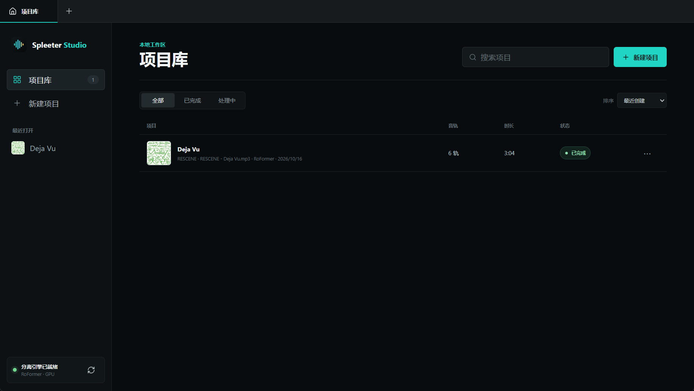
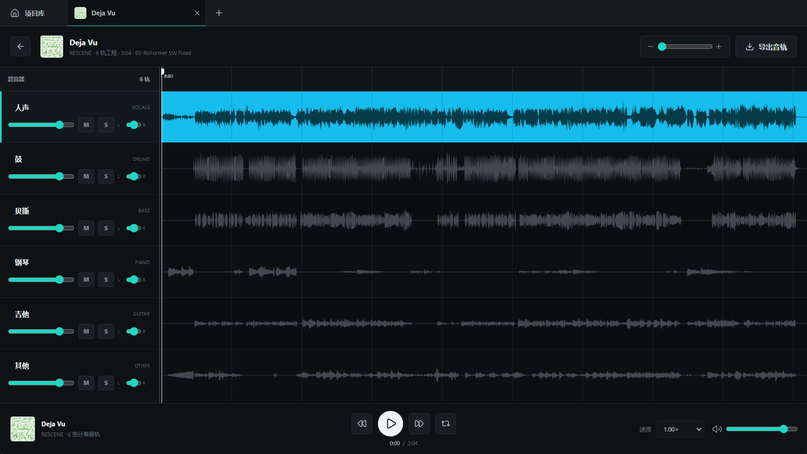

<h1 align="center">Spleeter Studio</h1>

<p align="center">
  
</p>

Spleeter Studio 1.1.0 是一个 Windows 桌面多轨工作区。分离引擎采用 PyTorch RoFormer。Electron 提供独立窗口、应用图标和桌面快捷方式，Web Audio 在本地同步播放与混音。

## 已实现

- 2 / 4 / 5 / 6 轨项目创建，按上传顺序逐个执行
- 项目库、状态轮询、失败重试和项目删除
- 真实 PCM 波形、时间轴缩放与播放头拖动
- 多轨同步播放、音量、静音、独奏、声像
- 主音量、播放速度、循环、前后 10 秒
- 单个项目的 WAV 音轨 ZIP 导出
- 独立 Electron 窗口、应用图标、Windows 安装包与桌面快捷方式
- 在界面中选择 RoFormer Python 环境，显示实际 GPU / CPU
- 按推理窗口更新进度、分离耗时、运行日志与中断任务恢复
- 24 位 WAV 导出，各轨使用同一防削波增益，保留音轨间的相对音量

## 界面截图

### 项目库

创建、搜索和管理本地分离项目，并查看每个项目的音轨数、时长和处理状态。



### 多轨编辑与混音

查看各音轨波形，独立控制人声、鼓、贝斯、钢琴、吉他和其他音轨的音量、静音、独奏与声像，并导出音频。



## 分离模式

| 模式 | 模型 | 输出 |
| --- | --- | --- |
| 2 轨 | Mel-Band RoFormer Big Beta 6X | 人声、伴奏 |
| 4 轨 | BS RoFormer SW Fixed 六轨模型 | 人声、鼓、贝斯、其他（包含吉他和钢琴） |
| 5 轨 | 同上 | 人声、鼓、贝斯、钢琴、其他（包含吉他） |
| 6 轨 | 同上 | 人声、鼓、贝斯、钢琴、吉他、其他 |

4 / 5 轨由六轨模型的真实输出相加合并；没有调用 Spleeter 或 Demucs。此前的 Spleeter 项目仍可播放和导出，不会自动重新分离或改写。

## 开发启动

```bat
cd SpleeterStudio
npm install
npm start
```

也可以双击 `start.cmd`。它打开的是独立桌面窗口，不会打开浏览器。

## 配置分离引擎

应用需要 Python 3.10 或以上、根目录 [requirements.txt](requirements.txt) 中的 Python 包，以及可用的 `ffmpeg` / `ffprobe`。界面检测不到环境时，点击“选择 Python”选择已配置的解释器。检测与推理都核验 CUDA 是否可用；GPU 使用 FP16，CPU 使用 FP32。

模型目录需要以下四个文件：

```text
melband_roformer_big_beta6x.ckpt
config_melbandroformer_big_beta6x.yaml
BS-Rofo-SW-Fixed.ckpt
BS-Rofo-SW-Fixed.yaml
```

可以用 `ROFORMER_PYTHON` 和 `ROFORMER_MODEL_DIR` 指定解释器与模型目录。权重约 2.4 GB，独立存放，不包含在安装包内；没有任何有效模型时界面会提示，缺少某个模型时禁用对应模式。模型下载地址和放置目录见 [docs/README.md](docs/README.md)。

权重及配置按固定 SHA-256 校验，模型缺失或损坏时显示实际路径，不自动删除或下载。分离使用本地模型，不请求在线模型目录。Electron 的本地页面直连，工作进程清理自身的代理环境变量；不会修改 Windows 代理或其他程序的设置。加载检查点时先放在 CPU，转换精度后移至 GPU，降低 4 GB 显卡的加载峰值。

## 验证与打包

```bash
npm run check
<RoFormer Python> -m unittest discover -s tests -v
npm run dist
```

安装包输出到 `dist\Spleeter-Studio-Setup-1.1.0.exe`。安装程序会创建桌面和开始菜单快捷方式。

项目数据默认保存在 Electron 的 `userData\projects` 目录，卸载应用不会主动删除项目音轨。

## 发布与许可证

代码以 [MIT](LICENSE) 许可证发布。模型权重不因应用代码的许可证而自动获得相同授权，也不会随仓库或安装包分发。部署方式、运行环境、模型下载地址和目录设置见 [docs/README.md](docs/README.md)。
